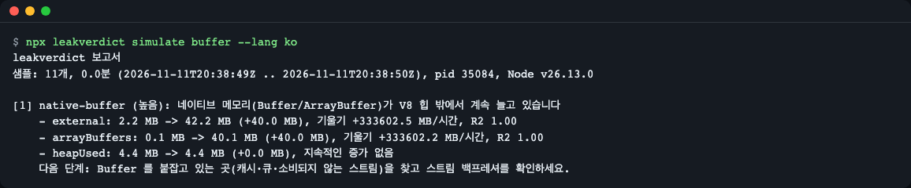
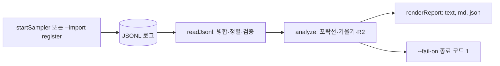
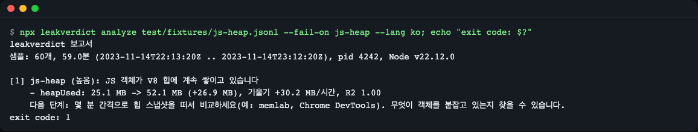
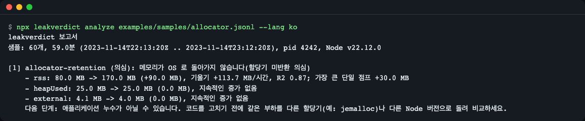
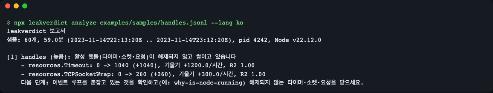
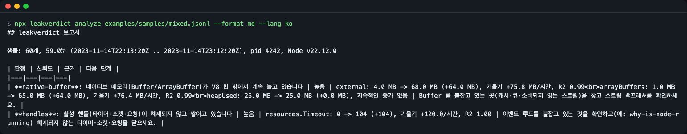

# leakverdict

[English](README.md) | **한국어**

leakverdict 는 `process.memoryUsage()` 시계열로 Node.js 메모리 증가가 어떤 종류인지(JS 힙 객체, 네이티브 Buffer, 해제되지 않은 핸들, 할당기가 돌려주지 않는 메모리) 알려 주는 진단 도구입니다. 내 프로세스 안에서 저비용으로 값을 쌓고, 오프라인으로 로그를 분석해 근거 수치와 다음 단계가 붙은 판정을 출력합니다. 런타임 의존성 0, Node 20 이상, ESM·CommonJS 모두 지원합니다.

배관을 뜯기 전에 계량기부터 읽는 것과 같습니다. 힙 스냅샷은 V8 힙만 보지만 메모리는 Buffer, 소켓·타이머, 할당기에서도 늘 수 있습니다. 이 도구는 어디부터 열어 볼지를 알려 줍니다.



*`leakverdict simulate buffer` 는 Buffer 를 붙잡는 실제 자식 프로세스를 띄워 값을 쌓고 판정을 출력합니다.*

## 설치

```bash
npm install github:LeeGyeongPil/leakverdict
```

Node 20 이상이 필요하고 런타임 의존성은 없습니다. 아직 npm 레지스트리에는 올라가 있지 않아 GitHub 에서 설치하거나(`prepare` 스크립트가 빌드합니다) 레포를 clone 합니다. 새 npm 버전(예: 11.x)은 GitHub 설치 중 `npm warn install-scripts ... leakverdict (prepare ...)` 경고를 낼 수 있습니다. 오류가 아니라 빌드 단계이고 설치는 그대로 됩니다. 아래 명령으로 승인해도 됩니다:

```bash
npm install-scripts approve leakverdict
```

npm 은 승인 내용을 프로젝트의 `package.json` 의 `allowScripts` 에 기록합니다. 패키지를 업데이트하면 다시 승인해야 합니다.

또는 레포를 clone 해서 데모를 실행합니다:

```bash
git clone https://github.com/LeeGyeongPil/leakverdict.git
cd leakverdict
npm install
npm run demo
```

`npm run demo` 는 빌드 후 `leakverdict simulate buffer` 를 실행합니다. 아래의 `npx leakverdict` 예시는 패키지를 설치한 프로젝트 안에서 동작하며, clone 한 레포에서는 `npx leakverdict` 대신 `node dist/esm/bin.js` 를 쓰세요.

## 빠르게 시작하기

라이브러리로 기록된 로그를 분석합니다(`examples/analyze-api.mjs`, 10줄).

```js
import { readJsonl, analyze, renderReport } from 'leakverdict';

const file = process.argv[2] ?? 'examples/samples/handles.jsonl';
const { rows, warnings } = await readJsonl(file);
const report = analyze(rows);

console.log(renderReport(report, { format: 'text', lang: 'en' }));
console.log('kinds:', report.findings.map((f) => `${f.kind} (${f.confidence})`).join(', '));
if (warnings.length > 0) console.log('warnings:', warnings.map((w) => w.code).join(', '));
```

```bash
node examples/analyze-api.mjs
```

```text
leakverdict report
Samples: 60 over 59.0 min (2023-11-14T22:13:20Z .. 2023-11-14T23:12:20Z), pid 4242, Node v22.12.0

[1] handles (high): Active handles (timers, sockets, requests) are never released
    - resources.Timeout: 0 -> 1040 (+1040), slope +1200.0/h, R2 1.00
    - resources.TCPSocketWrap: 0 -> 260 (+260), slope +300.0/h, R2 1.00
    Next step: List what keeps the event loop busy (for example with why-is-node-running) and close the timers, sockets and requests that are never released.

kinds: handles (high)
```

이 예제는 `lang: 'en'` 을 지정해 영어로 출력합니다. `lang: 'ko'` 로 바꾸면 한국어로 나옵니다. `examples/samples/*.jsonl` 은 원인을 아는 합성 로그라서, 실제 누수를 기다리지 않고 모든 판정을 시험해 볼 수 있습니다.

코드를 고치지 않고 내 프로세스를 기록하려면 샘플러를 사전 로드하고 파일을 분석합니다(Node v26.13.0 에서 실제 실행한 출력).

```bash
LEAKVERDICT_FILE=./mem.jsonl LEAKVERDICT_INTERVAL_MS=100 node --import leakverdict/register examples/buffer-app.mjs
npx leakverdict analyze mem.jsonl
```

```text
leakverdict report
Samples: 13 over 0.0 min (2026-11-11T20:36:49Z .. 2026-11-11T20:36:51Z), pid 33551, Node v26.13.0

[1] native-buffer (high): Native memory (Buffers/ArrayBuffers) keeps growing outside the V8 heap
    - external: 2.1 MB -> 16.1 MB (+14.0 MB), slope +49597.6 MB/h, R2 0.98
    - heapUsed: 4.9 MB -> 4.6 MB (-0.3 MB), no sustained growth
    Next step: Look for places that keep Buffers alive (caches, queues, unconsumed streams) and check stream backpressure.
```

앱은 보고서 앞에 `kept 8 buffers` 를 출력합니다. pid·시각·숫자는 실행마다 다르고, 실행에 따라 `external` 옆에 증거 줄(`arrayBuffers: ... MB`)이 하나 더 나올 수 있습니다. `examples/buffer-app.mjs`(8줄)는 2 MB Buffer 8개를 1초 남짓 붙잡을 뿐이라 시간당 기울기가 터무니없이 큽니다. 클론에서는 같은 변수로 `node --import ./dist/esm/register.js examples/buffer-app.mjs` 를 실행하세요. 실제 서비스는 기본 간격 60초로 분~일 단위로 돕니다.

## 핵심 개념

1. **샘플** - `rss`, `heapTotal`, `heapUsed`, `external`, `arrayBuffers` 와 활성 리소스 종류별 개수(`Timeout`, `TCPSocketWrap` 등)를 담은 JSONL 한 줄입니다. 측정 자체는 1~2마이크로초 정도이고(Node v26.13.0 실측: `process.memoryUsage()` 0.63마이크로초 + 리소스 200개일 때 `getActiveResourcesInfo()` 0.67마이크로초), 간격마다 작은 동기 파일 추가가 1회 더 듭니다.
2. **구간 최저점 포락선** - 로그를 8개 창으로 나누고 창마다 최솟값만 남깁니다. 가비지 컬렉션 때문에 메모리는 톱니처럼 오르내리는데, 최솟값만 이으면 그 잡음이 빠지고 진짜 추세만 남습니다.
3. **추세** - 지표마다 첫 창과 끝 창의 차이(delta), 직선의 기울기(시간당), 직선이 얼마나 잘 맞는지(R2)를 봅니다. delta 가 충분히 크고(기본 5 MB 이고 시작값의 10% 이상), 기울기가 양수이고, R2 가 0.5 이상일 때만 "증가"로 칩니다.
4. **판정** - 지표는 서로 겹칩니다(`rss` 는 힙을 포함하고 `external` 은 `arrayBuffers` 를 포함). 그래서 규칙이 함께 읽습니다.

| 계속 늘어나는 것 | 판정 | 제안하는 다음 단계 |
|---|---|---|
| `heapUsed` | `js-heap` | 힙 스냅샷 비교(예: memlab, Chrome DevTools) |
| `external` 또는 `arrayBuffers` | `native-buffer` | Buffer 를 붙잡는 곳 찾기, 스트림 백프레셔 확인 |
| 활성 리소스 개수 | `handles` | 이벤트 루프를 붙잡는 것 확인(예: why-is-node-running) |
| `rss` 만 늘고 위 항목으로 설명 안 됨 | `allocator-retention` (항상 `suspected`) | 다른 할당기나 다른 Node 버전으로 같은 작업 재실행 |
| 없음 | `none` | 고칠 것 없음 |

쓸 수 있는 행이 6개 미만이면 `insufficient-data` 가 나옵니다. 판정은 동시에 여러 개 나올 수 있고, `allocator-retention` 은 다른 판정이 하나도 없을 때만 나옵니다.



샘플러가 행을 쓰고, `readJsonl` 이 읽고(회전된 파일 포함), `analyze` 가 판정하고, `renderReport` 가 출력하고, `--fail-on` 이 판정을 CI 종료 코드로 바꿉니다.

## 사용법

코드 수정 없이 사전 로드로 수집합니다(프로세스마다 자기 파일을 쓰며 기본값은 `./leakverdict-<pid>.jsonl`).

| 변수 | 기본값 | 뜻 |
|---|---|---|
| `LEAKVERDICT_FILE` | `./leakverdict-<pid>.jsonl` | JSONL 출력 경로. 값 안의 `{pid}` 는 프로세스 id 로 바뀝니다 |
| `LEAKVERDICT_INTERVAL_MS` | `60000` | 샘플링 간격 |
| `LEAKVERDICT_MAX_BYTES` | `10000000` | 파일당 크기 상한 |
| `LEAKVERDICT_MAX_FILES` | `3` | 보관 파일 수(`mem.jsonl`, `mem.jsonl.1`, ...) |

`cluster` 나 PM2 cluster 모드에서는 모든 워커가 사전 로드를 물려받아 각자 `leakverdict-<pid>.jsonl` 을 쓰고 회전합니다. 볼 프로세스는 파일로 고릅니다(예: `npx leakverdict analyze leakverdict-12345.jsonl leakverdict-12345.jsonl.1`). cluster 의 primary 프로세스는 일을 하지 않으니 그 파일은 분석하지 마세요.

CommonJS 는 `node --require leakverdict/register app.cjs` 를 씁니다. 샘플러 타이머는 `unref` 되어 있어 프로세스를 붙잡지 않고, 프로세스가 끝날 때 마지막 한 줄을 더 씁니다.

CLI 로 분석합니다.

```bash
npx leakverdict analyze mem.jsonl mem.jsonl.1            # 회전된 파일을 함께 넘길 수 있음
npx leakverdict analyze mem.jsonl --format md            # CI 요약용 Markdown 표
npx leakverdict analyze mem.jsonl --format json          # 기계가 읽는 형식
npx leakverdict analyze mem.jsonl --fail-on js-heap      # js-heap 판정이면 종료 코드 1
npx leakverdict simulate buffer                          # 시나리오: buffer, jsobj, handle, churn, idle, release
```

종료 코드: `0` 정상, `1` `--fail-on` 판정 발견, `2` 입력·옵션 오류. `--fail-on` 은 `js-heap`, `native-buffer`, `handles`, `allocator-retention`, `none`, `insufficient-data`(쉼표로 여러 개) 또는 `any` 를 받습니다. `any` 는 `none` 과 `insufficient-data` 를 뺀 모든 판정에서 실패합니다.



*`--fail-on js-heap` 은 보고서를 출력하고 종료 코드 1 로 끝나서 CI 단계를 실패시킵니다.*

위 스크린샷은 테스트용 픽스처를 썼습니다. 이 레포의 샘플 로그로는 `node dist/esm/bin.js analyze examples/samples/js-heap.jsonl --fail-on js-heap` 를 실행하세요(샘플 로그는 npm 패키지에 들어 있지 않으니 클론이나 내 로그를 쓰세요). 클론에서 따라 해 볼 수 있는 다른 장면입니다. `node dist/esm/bin.js analyze examples/samples/allocator.jsonl`(힙은 돌아왔는데 `rss` 만 남은 경우), `examples/samples/handles.jsonl`(메모리는 평평한데 핸들이 쌓이는 경우), `examples/samples/mixed.jsonl --format md`(원인이 동시에 둘).



*`allocator-retention` 은 의심일 뿐입니다. 보고서도 애플리케이션 누수가 아닐 수 있다고 알려 줍니다.*



*메모리 그래프만 봐서는 놓치는 경우입니다. `Timeout` 과 `TCPSocketWrap` 개수가 늘어서 판정은 `handles` 입니다.*



*`--format md` 출력으로, CI 작업 요약에 그대로 붙일 수 있습니다. 이 로그는 원인이 두 개라 행이 두 개입니다.*

임계값은 `--min-samples`(기본 6), `--min-growth-mb`(기본 5), `--min-rel-growth`(기본 0.1, 시작 수준의 10%), `--min-r2`(기본 0.5)로 조정합니다. 증가는 절대 임계와 상대 임계를 모두 넘어야 하므로, 큰 힙(예: 1.5 GB 가 시간당 120 MB 씩 증가)에서는 10% 규칙이 진짜 추세를 가릴 수 있습니다. 그럴 때는 `--min-rel-growth 0.01` 처럼 낮추세요. `--min-growth-mb` 만 주면 옵션이 효과를 내도록 상대 임계가 0 이 됩니다. 여러 프로세스가 섞인 로그에서는 `--pid` 로 하나를 고릅니다.

## 언어

보고서와 오류 메시지는 영어와 한국어를 지원합니다. 결정 순서는 `--lang en|ko`, `LEAKVERDICT_LANG`, `LC_ALL`, `LC_MESSAGES`, `LANG` 이고 처음으로 비어 있지 않은 값이 정합니다(`ko` 로 시작하면 한국어, 그 밖에는 영어).

```bash
LEAKVERDICT_LANG=ko npx leakverdict analyze mem.jsonl
```

라이브러리에서는 `renderReport(report, { format, lang })` 와 `resolveLang()` 으로 같은 일을 합니다.

## API

`leakverdict` 가 내보내는 모든 것입니다(타입 포함, 그 밖은 내부용).

| 이름 | 하는 일 | 주요 인자 | 반환 |
|---|---|---|---|
| `startSampler(opts?)` | 지금 한 번, 이후 `intervalMs` 마다 샘플링. 앱으로 예외를 던지지 않음 | `file`, `intervalMs`(60000), `maxBytes`(10000000), `maxFiles`(3), `maxRows`(1440), `onError` | `Sampler` |
| `Sampler.count(name, n?)` | 모든 행에 기록되는 누적 카운터에 더함(예: 요청 수) | `name`, `n`(1) | `void` |
| `Sampler.sampleNow()` | 즉시 한 번 찍어 기록 | 없음 | `Row` |
| `Sampler.rows()` | 메모리 링 버퍼의 최근 행 | 없음 | `Row[]` |
| `Sampler.stop()` | 샘플링 중지. 두 번 불러도 안전 | 없음 | `Promise<void>` |
| `sampleOnce(counters?)` | 타이머·파일 없이 한 번 찍기 | `counters` | `Row` |
| `readJsonl(paths, opts?)` | JSONL 병합, 시간순 정렬, 중복 제거, 행 검증 | `paths`(문자열 또는 배열), `pid`, `readFile` | `Promise<{ rows, warnings }>` |
| `analyze(rows, opts?)` | 순수 함수: 같은 입력이면 같은 보고서 | `rows`, `windows`(8), `minSamples`(6), `minGrowthMB`(5), `minRelGrowth`(0.1), `minHandleGrowth`(10), `minR2`(0.5) | `Report` |
| `renderReport(report, opts)` | 보고서 출력 | `{ format: 'text' \| 'md' \| 'json', lang?: 'en' \| 'ko' }` | `string` |
| `resolveLang(arg?, env?)` | 위 순서로 언어 결정 | `arg`, `env` | `'en' \| 'ko'` |
| `validateRow(value)` | 파싱한 값을 행 스키마 v1 으로 검사 | `value` | `Row`(실패 시 `LeakverdictError`) |
| `LeakverdictError` | `code` 와 `params` 가 있는 오류 | 해당 없음 | 해당 없음 |

타입: `Sampler`, `SamplerOptions`, `ReadOptions`, `ReadResult`, `AnalyzeOptions`, `Report`(`span`, `findings`, `warnings`), `Finding`(`kind`, `confidence`, `evidence[]`, `next`), `Evidence`, `VerdictKind`(`js-heap`, `native-buffer`, `handles`, `allocator-retention`, `none`, `insufficient-data`), `Confidence`(`high`, `medium`, `low`, `suspected`), `NextStepCode`, `ReportFormat`, `Lang`, `Row`, `Warning`, `WarningCode`(`W_MULTIPLE_PIDS`, `W_MIXED_NODE`), `ErrorCode`.

오류는 다음 코드 중 하나를 가진 `LeakverdictError` 로 던져집니다. `E_FILE_NOT_FOUND`, `E_FILE_ACCESS`, `E_IS_DIRECTORY`, `E_EMPTY_INPUT`, `E_PARSE`, `E_SCHEMA`, `E_BAD_OPTION`, `E_UNKNOWN_OPTION`, `E_MISSING_VALUE`, `E_NO_FILES`, `E_UNKNOWN_SCENARIO`, `E_WRITE`, `E_SIMULATE_FAILED`. CLI 는 고른 언어로 읽기 쉬운 한 줄을 출력하고 종료 코드 2 로 끝납니다. 샘플러 안의 쓰기 실패는 던지지 않고 `onError` 로 전달됩니다.

### 데이터 형식(행 스키마 v1)

한 줄에 JSON 객체 하나이고, 메모리 값은 `process.memoryUsage()` 가 돌려주는 바이트 단위입니다.

```json
{"v":1,"t":1700000000000,"pid":4242,"threadId":0,"node":"v22.12.0","rss":83901794,"heapTotal":42094083,"heapUsed":26365443,"external":4202412,"arrayBuffers":1096411,"resources":{"PipeWrap":1,"TCPServerWrap":1,"Timeout":0,"TCPSocketWrap":0}}
```

`t` 는 epoch 밀리초, `resources` 는 `process.getActiveResourcesInfo()` 의 종류별 개수, 선택 항목 `counters` 는 직접 세는 누적 카운터입니다. 다른 수집기의 로그도 이 모양으로 바꾸면 쓸 수 있습니다.

## 사용 예

`examples/` 의 실행 가능한 파일입니다.

- `examples/analyze-api.mjs` - 위 빠르게 시작하기 예제.
- `examples/sampler-basic.mjs` - 내 프로세스 안에서 기록하고 행을 메모리에 보관:

```bash
node examples/sampler-basic.mjs
```

```text
rows: 6
last row keys: v,t,pid,threadId,node,rss,heapTotal,heapUsed,external,arrayBuffers,resources,counters
counters: {"requests":50}
```

- `examples/http-server.mjs` - 샘플러를 붙이고 요청 수를 세며, 요청마다 64 KiB Buffer 를 일부러 붙잡는 작은 HTTP 서버입니다. 5초마다 샘플을 남기고 요청마다 64 KiB 를 붙잡기 때문에, 5 MB 임계를 넘고 행이 6개 이상 쌓이려면 약 40초와 수천 개의 요청이 필요합니다. 한 터미널에서 `node examples/http-server.mjs --exit-after 40000` 을 실행합니다(스스로 끝나며 `mem.jsonl` 을 남깁니다). 다른 터미널에서 약 38초 동안 부하를 보냅니다.

```bash
node -e "const http=require('http');let n=0;const t=setInterval(()=>{for(let i=0;i<10;i++)http.get('http://127.0.0.1:3000',r=>r.resume());if(++n>=380)clearInterval(t)},100)"
npx leakverdict analyze mem.jsonl
```

기대 결과: external 과 arrayBuffers 가 약 170 MB 늘어난 `native-buffer (high)` 입니다(Node v26.13.0 실행에서 `external: 4.2 MB -> 181.8 MB`). 열린 소켓 때문에 약한 두 번째 판정 `handles (low)` 가 함께 나올 수 있습니다. 요청이 적거나 실행이 짧으면 `none` 이나 `insufficient-data` 로 끝납니다.

## 언제 쓰나

- 잘 맞는 경우: `rss` 가 계속 오르는 장기 실행 Node 서비스에서 힙 스냅샷을 뜨기 전에 어떤 종류의 증가인지 알고 싶을 때, 힙이나 핸들이 계속 늘면 실패해야 하는 소크 테스트.
- 누수가 나는 코드 줄을 찾아 주지는 않습니다. 어디를 볼지 알려 줍니다.
- 붙잡고 있는 객체를 찾으려면 [memlab](https://github.com/facebook/memlab) 이나 Chrome DevTools 힙 스냅샷, 이벤트 루프를 살려 두는 것을 보려면 [why-is-node-running](https://github.com/mafintosh/why-is-node-running), 프로파일링·플레임 그래프는 [Clinic.js](https://clinicjs.org/), 실시간 지표 대시보드는 [prom-client](https://github.com/siimon/prom-client) 를 보세요. 각 도구가 다루는 범위는 해당 공식 문서를 확인하세요.

## 한계

- `process.getActiveResourcesInfo()` 가 알려 주는 리소스 종류만 셉니다. `unref` 된 애플리케이션 타이머는 거기에도 보이지 않습니다. 샘플러 자신의 타이머도 `unref` 되어 있어 나타나지 않습니다.
- 워커 스레드에서 `rss` 는 워커가 아니라 프로세스 전체 값입니다.
- 일부 임베디드 런타임은 `arrayBuffers` 를 0 으로 보고합니다. 그 경우 `external` 만 씁니다.
- `allocator-retention` 은 증거가 아니라 의심입니다. `rss` 는 늘었는데 힙·`external`·핸들은 늘지 않았다는 뜻입니다. 다른 할당기(예: jemalloc)나 다른 Node 버전으로 같은 작업을 돌려 확인하세요.
- `simulate churn` 과 `simulate release` 는 OS·할당기에 따라 달라서 기계마다 판정이 다릅니다. 이 문서를 쓴 macOS 에서 `simulate release` 는 `allocator-retention (suspected)` 을 냈지만 다른 환경에서 같다고 기대하지 마세요.
- 아주 짧은 실행(예: 1초 정도의 `simulate`)은 기울기를 시간당으로 환산하기 때문에 터무니없이 큰 값이 나옵니다. 실제 판단에는 분~시간 단위 데이터를 쓰세요.
- 한 번 오르고 멈추는 계단(캐시 워밍업, 풀 채우기)도 증가로 보고될 수 있습니다(`js-heap` medium, 로그 처음 20%의 워밍업 구간은 `js-heap` low). 워밍업이 끝난 뒤부터 기록하거나 분석하세요.
- 로그 맨 끝에서야 시작된 증가는 아직 잡히지 않습니다. 하한 포락선이 창별 최솟값을 쓰기 때문입니다(예: 60행 중 마지막 3행에서 +200 MB 면 `none`). 계속 수집한 뒤 다시 분석하세요.
- 임계값 옵션에 음수를 공백으로 띄워 주면(`--min-rel-growth -1`) "0 이상이어야 합니다" 대신 "값이 필요합니다" 로 보고됩니다. 인자 파서가 모호한 인자로 보기 때문입니다. `--min-rel-growth=-1` 로 쓰면 정확한 메시지가 나옵니다. 종료 코드는 어느 쪽이든 2 입니다.
- 한 파일에 프로세스가 여러 개면 하나(마지막 것, 또는 `--pid`)만 분석하고 경고를 냅니다. Node 버전이 섞여 있어도 경고가 나옵니다.

시간 비례와 트래픽 비례 증가 구분, SVG 차트, `run -- <command>` 래퍼는 이후 마일스톤에서 계획 중이며 이번 릴리스에는 없습니다.

## 문제 해결

| 증상 | 원인 | 해결 |
|---|---|---|
| `Not enough data for a verdict`(`--lang ko` 는 데이터 부족 메시지) | 쓸 수 있는 행이 6개 미만 | 샘플러를 더 오래 돌리거나 `--min-samples` 를 낮춤(최소 3) |
| `File not found: ...`(`--lang ko` 는 "파일을 찾을 수 없습니다")와 종료 코드 2 | 경로가 틀렸거나 회전된 파일이 빠짐 | 경로를 확인하고 `mem.jsonl mem.jsonl.1` 을 함께 넘김 |
| `Give at least one JSONL file to analyze`(`--lang ko` 는 JSONL 파일을 하나 이상 달라는 메시지)와 종료 코드 2 | `analyze` 를 파일 없이 실행 | 파일을 넘김(예: `leakverdict-<pid>.jsonl`) |
| cluster 앱에서 `none` 이거나 행이 1개 | 일을 하지 않는 cluster primary 의 파일을 분석함 | 워커의 `leakverdict-<pid>.jsonl` 을 분석 |
| 대시보드에서는 메모리가 오른 것 같은데 `none` | 증가가 5 MB·10% 미만이거나, 추세 없는 톱니 로그 | 더 오래 수집하거나 `--min-rel-growth` 를 낮춤(예: `0.01`. 큰 힙에서는 상대 임계 10% 가 추세를 가립니다. `--min-growth-mb` 만 줘도 상대 임계가 0 이 됩니다) |
| `--import leakverdict/register` 에서 `Cannot find package 'leakverdict'` | 패키지가 설치된 프로젝트 밖에서 실행 | 앱에 패키지를 설치하거나 `dist/esm/register.js` 경로를 직접 지정 |

## 버전·호환성

- [SemVer](https://semver.org/)를 따릅니다. 0.x 동안은 마이너 버전에서 API 가 바뀔 수 있고, 바뀌면 [CHANGELOG.md](CHANGELOG.md)에 적습니다.
- CI 에서 Node 20, 22, 24 를 테스트합니다. 테스트 묶음은 로컬에서 Node 20.20.2, 22.23.4, 26.13.0 에서도 통과했습니다.

## 개발·기여

```bash
git clone https://github.com/LeeGyeongPil/leakverdict.git
cd leakverdict
npm install
LANG=C.UTF-8 LC_ALL=C.UTF-8 npm test   # tsc(strict) 빌드 후 테스트 72개
node scripts/check-pack.mjs            # 패키징 후 다른 곳에 tarball 을 설치해 ESM·CJS·bin 확인
```

## 라이선스

MIT. [LICENSE](LICENSE) 를 보세요.
