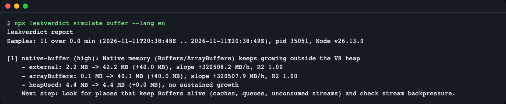
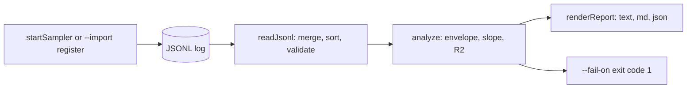
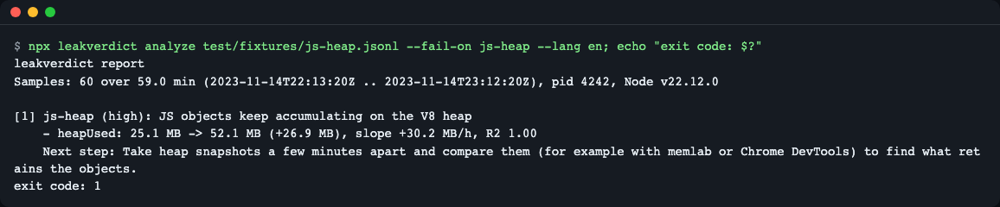
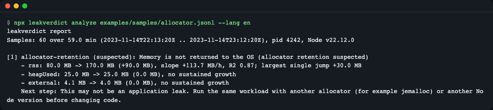
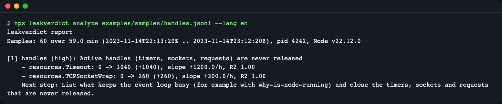
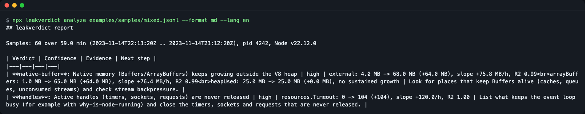

# leakverdict

**English** | [한국어](README.ko.md)

leakverdict tells you which kind of Node.js memory growth you have (JS heap objects, native Buffers, unreleased handles, or memory the allocator does not give back) from a time series of `process.memoryUsage()` values. It samples cheaply inside your process, then analyzes the log offline and prints a verdict with the numbers behind it and a suggested next step. Zero runtime dependencies, Node 20+, ESM and CommonJS.

Think of it as reading the meter before you open the pipes: a heap snapshot only sees the V8 heap, but memory can also grow in Buffers, in sockets and timers, or in the allocator. This tool tells you which place to open first.



*`leakverdict simulate buffer` starts a real child process that keeps Buffers alive, samples it, and prints the verdict.*

## Install

```bash
npm install github:LeeGyeongPil/leakverdict
```

Requires Node 20 or newer. There are no runtime dependencies. The package is not on the npm registry yet, so install it from GitHub (the `prepare` script builds it) or clone the repo. Newer npm versions (for example 11.x) may print `npm warn install-scripts ... leakverdict (prepare ...)` during a GitHub install. That is the build step, not an error; the install still works, and you can approve it:

```bash
npm install-scripts approve leakverdict
```

npm records the approval in the project's `package.json` under `allowScripts`. After you update the package, approve it again.

Or clone the repo and run the demo:

```bash
git clone https://github.com/LeeGyeongPil/leakverdict.git
cd leakverdict
npm install
npm run demo
```

`npm run demo` builds the project and runs `leakverdict simulate buffer`. Examples below that use `npx leakverdict` work inside a project where the package is installed; in a clone, use `node dist/esm/bin.js` instead of `npx leakverdict`.

## Quick start

Analyze a recorded log with the library (`examples/analyze-api.mjs`, 10 lines):

```js
import { readJsonl, analyze, renderReport } from 'leakverdict';

const file = process.argv[2] ?? 'examples/samples/handles.jsonl';
const { rows, warnings } = await readJsonl(file);
const report = analyze(rows);

console.log(renderReport(report, { format: 'text', lang: 'en' }));
console.log('kinds:', report.findings.map((f) => `${f.kind} (${f.confidence})`).join(', '));
if (warnings.length > 0) console.log('warnings:', warnings.map((w) => w.code).join(', '));
```

```bash
node examples/analyze-api.mjs
```

```text
leakverdict report
Samples: 60 over 59.0 min (2023-11-14T22:13:20Z .. 2023-11-14T23:12:20Z), pid 4242, Node v22.12.0

[1] handles (high): Active handles (timers, sockets, requests) are never released
    - resources.Timeout: 0 -> 1040 (+1040), slope +1200.0/h, R2 1.00
    - resources.TCPSocketWrap: 0 -> 260 (+260), slope +300.0/h, R2 1.00
    Next step: List what keeps the event loop busy (for example with why-is-node-running) and close the timers, sockets and requests that are never released.

kinds: handles (high)
```

`examples/samples/*.jsonl` are synthetic logs with a known cause, so you can try every verdict without waiting for a real leak.

To record your own process with no code change, preload the sampler and then analyze the file (output from a real run, Node v26.13.0):

```bash
LEAKVERDICT_FILE=./mem.jsonl LEAKVERDICT_INTERVAL_MS=100 node --import leakverdict/register examples/buffer-app.mjs
npx leakverdict analyze mem.jsonl
```

```text
leakverdict report
Samples: 13 over 0.0 min (2026-11-11T20:36:49Z .. 2026-11-11T20:36:51Z), pid 33551, Node v26.13.0

[1] native-buffer (high): Native memory (Buffers/ArrayBuffers) keeps growing outside the V8 heap
    - external: 2.1 MB -> 16.1 MB (+14.0 MB), slope +49597.6 MB/h, R2 0.98
    - heapUsed: 4.9 MB -> 4.6 MB (-0.3 MB), no sustained growth
    Next step: Look for places that keep Buffers alive (caches, queues, unconsumed streams) and check stream backpressure.
```

The app prints `kept 8 buffers` before the report. Pid, timestamps and numbers differ on every run, and a run may add one more evidence line (`arrayBuffers: ... MB`) next to `external`. `examples/buffer-app.mjs` (8 lines) keeps eight 2 MB Buffers alive for about a second, so the per-hour slope is absurdly large. Run it from a clone as `node --import ./dist/esm/register.js examples/buffer-app.mjs` with the same variables. Real services run for minutes to days, with the default interval of 60 seconds.

## Core concepts

1. **Sample** - one JSONL row with `rss`, `heapTotal`, `heapUsed`, `external`, `arrayBuffers` and the count of each active resource kind (`Timeout`, `TCPSocketWrap`, ...). The measurement itself takes about 1 to 2 microseconds (`process.memoryUsage()` 0.63 microseconds plus `getActiveResourcesInfo()` with 200 resources 0.67 microseconds, measured on Node v26.13.0), plus one small synchronous file append per interval.
2. **Lower envelope** - the log is cut into 8 windows and the minimum of each window is kept. Garbage collection makes memory saw-tooth up and down; the minimums drop that noise and keep the real trend.
3. **Trend** - for each metric, leakverdict compares the first and last window (delta), fits a line (slope per hour) and checks how well it fits (R2). A metric "grew" only when the delta is large enough (default 5 MB and 10 percent), the slope is positive and R2 is at least 0.5.
4. **Verdict** - the metrics overlap (`rss` contains the heap, `external` contains `arrayBuffers`), so the rules read them together:

| What keeps growing | Verdict | Next step it suggests |
|---|---|---|
| `heapUsed` | `js-heap` | heap snapshots, for example with memlab or Chrome DevTools |
| `external` or `arrayBuffers` | `native-buffer` | find what keeps Buffers alive, check stream backpressure |
| active resource counts | `handles` | list what keeps the event loop busy, for example with why-is-node-running |
| only `rss`, nothing above explains it | `allocator-retention` (always `suspected`) | run the same workload with another allocator or Node version |
| nothing | `none` | nothing to fix |

If there are fewer than 6 usable rows you get `insufficient-data`. Several verdicts can appear at once, and `allocator-retention` only appears when no other verdict does.



The sampler writes rows, `readJsonl` loads them (rotated files included), `analyze` decides, `renderReport` prints, and `--fail-on` turns a verdict into an exit code for CI.

## Usage

Collect with the preload, no code change (each process writes its own file, `./leakverdict-<pid>.jsonl` by default):

| Variable | Default | Meaning |
|---|---|---|
| `LEAKVERDICT_FILE` | `./leakverdict-<pid>.jsonl` | JSONL output path; `{pid}` in the value is replaced by the process id |
| `LEAKVERDICT_INTERVAL_MS` | `60000` | sampling interval |
| `LEAKVERDICT_MAX_BYTES` | `10000000` | size cap per file |
| `LEAKVERDICT_MAX_FILES` | `3` | files kept (`mem.jsonl`, `mem.jsonl.1`, ...) |

With `cluster` or PM2 cluster mode every worker inherits the preload, so each one writes and rotates its own `leakverdict-<pid>.jsonl`. Pick the process to inspect by file, for example `npx leakverdict analyze leakverdict-12345.jsonl leakverdict-12345.jsonl.1`. The primary process of a cluster does no work, so do not analyze its file.

For CommonJS use `node --require leakverdict/register app.cjs`. The sampler timer is `unref`'d, so it never keeps your process alive, and it writes one last row when the process exits.

Analyze with the CLI:

```bash
npx leakverdict analyze mem.jsonl mem.jsonl.1            # rotated files can be passed together
npx leakverdict analyze mem.jsonl --format md            # Markdown table for CI summaries
npx leakverdict analyze mem.jsonl --format json          # machine readable
npx leakverdict analyze mem.jsonl --fail-on js-heap      # exit code 1 if a js-heap verdict is found
npx leakverdict simulate buffer                          # scenarios: buffer, jsobj, handle, churn, idle, release
```

Exit codes: `0` ok, `1` a `--fail-on` verdict was found, `2` input or option error. `--fail-on` accepts `js-heap`, `native-buffer`, `handles`, `allocator-retention`, `none`, `insufficient-data` (comma separated) or `any`. `any` fails on every verdict except `none` and `insufficient-data`.



*`--fail-on js-heap` prints the report and exits with code 1, which fails a CI step.*

The screenshot above used a test fixture; with the sample logs in this repo run `node dist/esm/bin.js analyze examples/samples/js-heap.jsonl --fail-on js-heap` (the sample logs are not part of the npm package, so use a clone, or your own log). Other scenes you can reproduce from a clone: `node dist/esm/bin.js analyze examples/samples/allocator.jsonl` (heap recovered but `rss` stayed up), `examples/samples/handles.jsonl` (handles piling up while memory looks flat) and `examples/samples/mixed.jsonl --format md` (two causes at once).



*`allocator-retention` is only a suspicion. The report says it may not be an application leak.*



*A memory graph alone would miss this: `Timeout` and `TCPSocketWrap` counts grow, so the verdict is `handles`.*



*`--format md` output, ready to paste into a CI job summary. This log has two causes at once, so two rows.*

Tune thresholds with `--min-samples` (default 6), `--min-growth-mb` (default 5), `--min-rel-growth` (default 0.1, meaning 10 percent of the starting level) and `--min-r2` (default 0.5). Growth must pass both the absolute and the relative threshold, so on a large heap (for example 1.5 GB growing 120 MB per hour) the 10 percent rule can hide a real trend: lower it with `--min-rel-growth 0.01`. If you pass only `--min-growth-mb`, the relative threshold is set to 0 so that the option has an effect. Pick one process from a log that contains several with `--pid`.

## Language

Reports and error messages come in English and Korean. The order is `--lang en|ko`, then `LEAKVERDICT_LANG`, then `LC_ALL`, `LC_MESSAGES` and `LANG` (the first non-empty one decides; a value starting with `ko` means Korean, anything else English).

```bash
LEAKVERDICT_LANG=ko npx leakverdict analyze mem.jsonl
```

The library does the same with `renderReport(report, { format, lang })` and `resolveLang()`.

## API

Everything exported from `leakverdict` (types are included; anything else is internal).

| Name | What it does | Main arguments | Returns |
|---|---|---|---|
| `startSampler(opts?)` | Starts sampling now and then every `intervalMs`; never throws into your app | `file`, `intervalMs` (60000), `maxBytes` (10000000), `maxFiles` (3), `maxRows` (1440), `onError` | `Sampler` |
| `Sampler.count(name, n?)` | Adds to a cumulative counter recorded in every row (for example requests) | `name`, `n` (1) | `void` |
| `Sampler.sampleNow()` | Takes and writes one sample immediately | none | `Row` |
| `Sampler.rows()` | Latest rows from the in-memory ring buffer | none | `Row[]` |
| `Sampler.stop()` | Stops sampling; safe to call twice | none | `Promise<void>` |
| `sampleOnce(counters?)` | One sample, no timer, no file | `counters` | `Row` |
| `readJsonl(paths, opts?)` | Reads and merges JSONL files, sorts by time, drops duplicates, validates rows | `paths` (string or array), `pid`, `readFile` | `Promise<{ rows, warnings }>` |
| `analyze(rows, opts?)` | Pure function: same rows and options give the same report | `rows`, `windows` (8), `minSamples` (6), `minGrowthMB` (5), `minRelGrowth` (0.1), `minHandleGrowth` (10), `minR2` (0.5) | `Report` |
| `renderReport(report, opts)` | Renders a report | `{ format: 'text' \| 'md' \| 'json', lang?: 'en' \| 'ko' }` | `string` |
| `resolveLang(arg?, env?)` | Picks the language by the order above | `arg`, `env` | `'en' \| 'ko'` |
| `validateRow(value)` | Checks a parsed value against row schema v1 | `value` | `Row` (throws `LeakverdictError`) |
| `LeakverdictError` | Error with `code` and `params` | n/a | n/a |

Types: `Sampler`, `SamplerOptions`, `ReadOptions`, `ReadResult`, `AnalyzeOptions`, `Report` (`span`, `findings`, `warnings`), `Finding` (`kind`, `confidence`, `evidence[]`, `next`), `Evidence`, `VerdictKind` (`js-heap`, `native-buffer`, `handles`, `allocator-retention`, `none`, `insufficient-data`), `Confidence` (`high`, `medium`, `low`, `suspected`), `NextStepCode`, `ReportFormat`, `Lang`, `Row`, `Warning`, `WarningCode` (`W_MULTIPLE_PIDS`, `W_MIXED_NODE`), `ErrorCode`.

Errors are thrown as `LeakverdictError` with one of these codes: `E_FILE_NOT_FOUND`, `E_FILE_ACCESS`, `E_IS_DIRECTORY`, `E_EMPTY_INPUT`, `E_PARSE`, `E_SCHEMA`, `E_BAD_OPTION`, `E_UNKNOWN_OPTION`, `E_MISSING_VALUE`, `E_NO_FILES`, `E_UNKNOWN_SCENARIO`, `E_WRITE`, `E_SIMULATE_FAILED`. The CLI renders them as one readable line in the chosen language and exits with code 2. Write failures inside the sampler go to `onError` instead of being thrown.

### Data format (row schema v1)

One JSON object per line, memory values in bytes as returned by `process.memoryUsage()`:

```json
{"v":1,"t":1700000000000,"pid":4242,"threadId":0,"node":"v22.12.0","rss":83901794,"heapTotal":42094083,"heapUsed":26365443,"external":4202412,"arrayBuffers":1096411,"resources":{"PipeWrap":1,"TCPServerWrap":1,"Timeout":0,"TCPSocketWrap":0}}
```

`t` is epoch milliseconds, `resources` maps kinds from `process.getActiveResourcesInfo()` to counts, and an optional `counters` object holds your cumulative counters. Logs from other collectors work if you convert them to this shape.

## More examples

Runnable files in `examples/`:

- `examples/analyze-api.mjs` - the quick start above.
- `examples/sampler-basic.mjs` - record inside your process, keep rows in memory:

```bash
node examples/sampler-basic.mjs
```

```text
rows: 6
last row keys: v,t,pid,threadId,node,rss,heapTotal,heapUsed,external,arrayBuffers,resources,counters
counters: {"requests":50}
```

- `examples/http-server.mjs` - a small HTTP server that attaches the sampler, counts requests and deliberately keeps a 64 KiB Buffer per request. It samples every 5 seconds and each request keeps 64 KiB, so you need about 40 seconds and a few thousand requests to cross the 5 MB threshold with at least 6 rows. In one terminal run `node examples/http-server.mjs --exit-after 40000` (it stops itself and writes `mem.jsonl`). In another, send load for about 38 seconds:

```bash
node -e "const http=require('http');let n=0;const t=setInterval(()=>{for(let i=0;i<10;i++)http.get('http://127.0.0.1:3000',r=>r.resume());if(++n>=380)clearInterval(t)},100)"
npx leakverdict analyze mem.jsonl
```

Expected: `native-buffer (high)` with external and arrayBuffers growing by about 170 MB (a run on Node v26.13.0 showed `external: 4.2 MB -> 181.8 MB`). A weak second finding, `handles (low)` from the open sockets, can appear next to it. Fewer requests or a shorter run end in `none` or `insufficient-data`.

## When to use it

- Good fit: a long-running Node service whose `rss` keeps climbing and you want to know which kind of growth it is before taking heap snapshots; a soak test that should fail when the heap or handles keep growing.
- It does not find the line of code that leaks. It tells you where to look.
- For finding the retaining objects, see [memlab](https://github.com/facebook/memlab) or Chrome DevTools heap snapshots. For what keeps the event loop alive, see [why-is-node-running](https://github.com/mafintosh/why-is-node-running). For profiling and flame graphs, see [Clinic.js](https://clinicjs.org/). For live metrics dashboards, see [prom-client](https://github.com/siimon/prom-client). Check their own docs for what they cover.

## Limitations

- Only resource kinds that Node reports through `process.getActiveResourcesInfo()` are counted. An application timer that was `unref`'d is not visible there either; the sampler's own timer is `unref`'d and does not show up.
- In a worker thread, `rss` is for the whole process, not for the worker.
- Some embedded runtimes report `arrayBuffers` as 0; then only `external` is used.
- `allocator-retention` is a suspicion, never proof: it means `rss` grew while the heap, `external` and handles did not. Confirm it by running the same workload with another allocator (for example jemalloc) or another Node version.
- `simulate churn` and `simulate release` depend on the OS and allocator, so their verdict differs between machines. On the macOS machine used for these docs, `simulate release` reported `allocator-retention (suspected)`; do not expect the same elsewhere.
- Very short runs (such as `simulate`, about a second) show huge per-hour slopes because slopes are converted to per hour. Use minutes or hours of data for real decisions.
- A step that rises once and then stays flat (cache warm-up, filling a pool) can still be reported as growth (`js-heap`, medium; a warm-up ramp in the first 20 percent of the log gives `js-heap`, low). Start recording, or analyze, after warm-up.
- Growth that only starts at the very end of the log is not caught yet, because the lower envelope uses each window's minimum (for example +200 MB in the last 3 of 60 rows gives `none`). Keep collecting and analyze again.
- A negative number as the value of a threshold option written with a space (`--min-rel-growth -1`) is reported as "needs a value" instead of "must be 0 or more", because the argument parser treats it as ambiguous. Write `--min-rel-growth=-1` to get the exact message. The exit code is 2 either way.
- Several processes in one file: only one is analyzed (the last, or `--pid`), with a warning. Mixed Node versions also produce a warning.

Planned for a later milestone and not part of this release: traffic-proportional versus time-proportional growth, an SVG chart, a `run -- <command>` wrapper.

## Troubleshooting

| Symptom | Cause | Fix |
|---|---|---|
| `Not enough data for a verdict` | fewer than 6 usable rows | keep the sampler running longer, or lower `--min-samples` (minimum 3) |
| `File not found: ...` and exit code 2 | wrong path or a rotated file is missing | check the path and pass `mem.jsonl mem.jsonl.1` together |
| `Give at least one JSONL file to analyze` and exit code 2 | `analyze` was run without a file | pass the file, for example `leakverdict-<pid>.jsonl` |
| `none` or one row from a cluster app | you analyzed the cluster primary's file, which does no work | analyze a worker's `leakverdict-<pid>.jsonl` |
| `none` although memory looks higher in your dashboard | growth below 5 MB / 10 percent, or the log is a saw-tooth without a trend | collect longer, or lower `--min-rel-growth` (for example `0.01`; on a large heap the 10 percent relative threshold is what hides the trend; `--min-growth-mb` alone also sets it to 0) |
| `Cannot find package 'leakverdict'` from `--import leakverdict/register` | run outside a project that has the package installed | install the package in the app, or give the path to `dist/esm/register.js` |

## Versioning and compatibility

- Follows [SemVer](https://semver.org/). While the version is 0.x, minor versions may change the API; changes are listed in [CHANGELOG.md](CHANGELOG.md).
- Node 20, 22 and 24 are tested in CI; the test suite also passed locally on Node 20.20.2, 22.23.4 and 26.13.0.

## Development

```bash
git clone https://github.com/LeeGyeongPil/leakverdict.git
cd leakverdict
npm install
LANG=C.UTF-8 LC_ALL=C.UTF-8 npm test   # build with tsc (strict), then 72 tests
node scripts/check-pack.mjs            # packs, installs the tarball elsewhere, checks ESM, CJS and the bin
```

## License

MIT. See [LICENSE](LICENSE).
